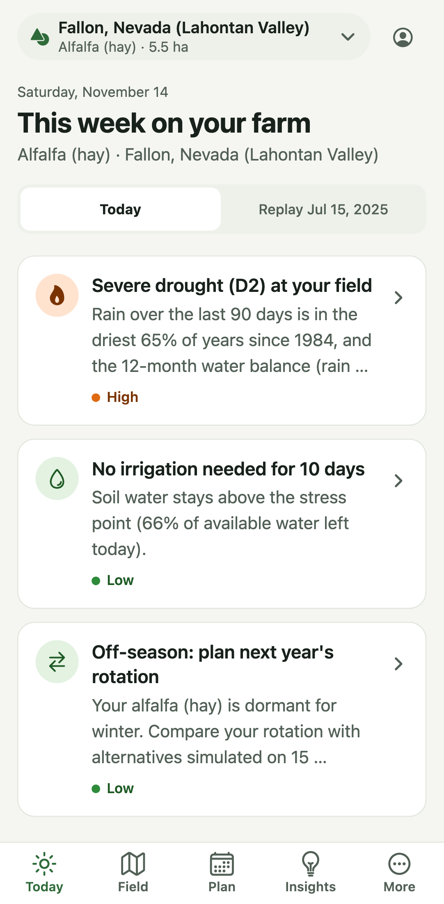
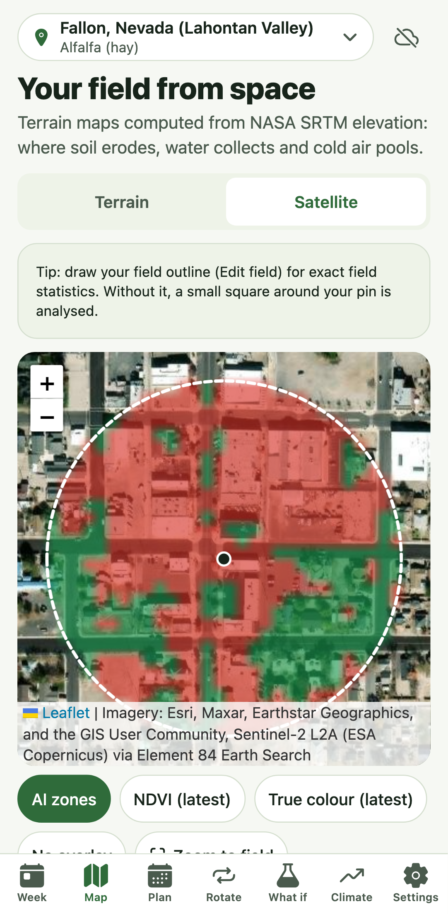
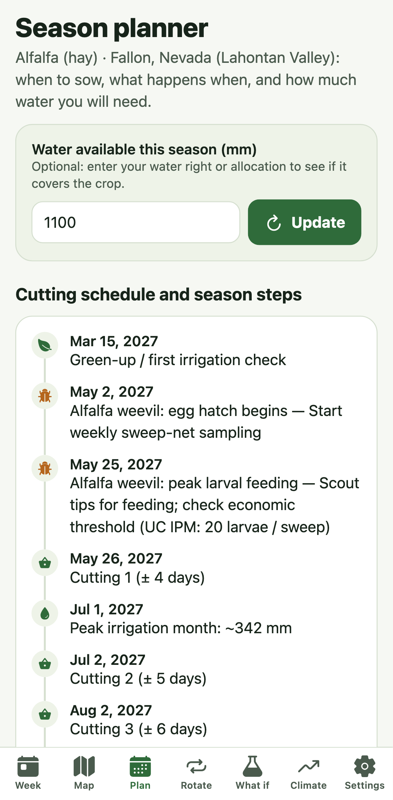
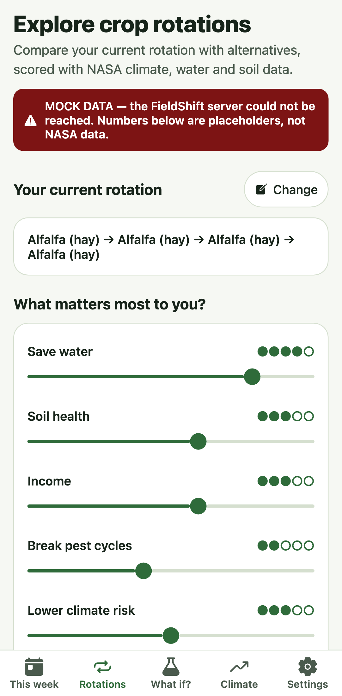
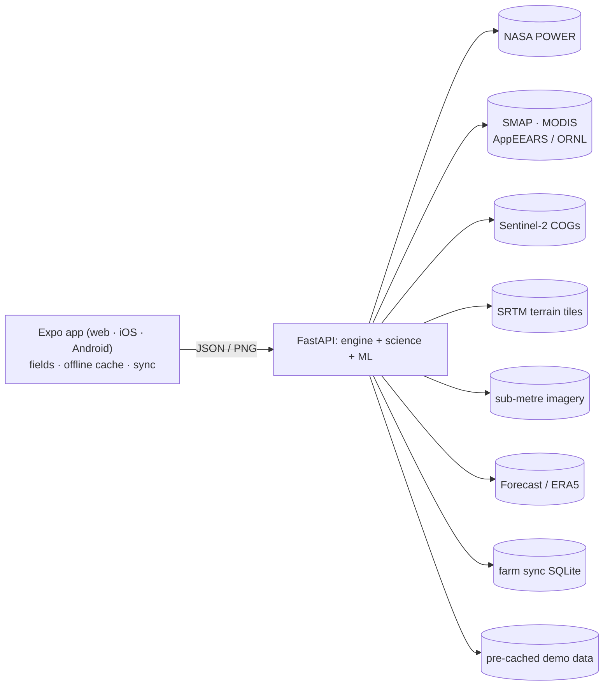

# FieldShift: 40 years of NASA data, turned into this week's farm decisions

**NASA Space Apps Challenge 2026 · "Field Shift: Adapting Farms with NASA Data"** · Web · iOS · Android · syncs phone ↔ PC · 6 languages · works offline

FieldShift lets a farmer **outline every field on sub-metre satellite imagery** (or tap once and let FieldShift find the boundary), then answers, for each field:

1. **"What should I do this week, and why?"** At most three ranked action cards: *Irrigate 38 mm by Thursday*, *High stripe-rust risk from Friday: inspect leaves*, *Fall armyworm: scout weekly*.
2. **"What is happening inside my field?"**
   - 10 m **Sentinel-2** NDVI history with detected green-up, peak and bare periods;
   - **AI management zones**;
   - computed **terrain maps**: erosion (RUSLE), wetness, frost hollows, slope.
3. **"How should I plan this season?"** Sowing window, crop-stage and pest-scouting timeline, a monthly water budget against the farmer's allocation, and a frost/heat risk calendar.
4. **"Is my rotation ready for the climate I actually farm in?"** The current rotation vs. ≥ 3 alternatives, simulated on 15 seasons of NASA weather at that field and scored on water, income, soil health, erosion, pest cycles and climate risk. Each comes with why it was suggested, the evidence, the benefits, the information gaps, and what needs local review.

Every number is one tap from its evidence. The **Why?** view shows:
- the data against the normal;
- the model and its equations;
- confidence and its reason;
- honest caveats;
- each source with its resolution, latency and date.

| This week | Field from space | Plan | Field Shift (rotations) |
|---|---|---|---|
|  |  |  |  |

More: [iOS](media/) and [Android](media/) captures, web screenshots of the [map](media/web-map-desktop.png), [field editor](media/web-fields-desktop.png) and [sync](media/web-sync-mobile.png), and [`media/BUILDS.md`](media/BUILDS.md).

## The story: Lahontan Valley, Nevada
The challenge photo shows a Nevada alfalfa farmer, so FieldShift's hero demo is a real ~5.5 ha border-irrigated alfalfa field near Fallon. The NASA POWER record there shows:
- **days ≥ 35 °C** rising from **26 to 50 a year** since 1984;
- **warm-season rain** falling from **95 to 55 mm**;
- **July crop water demand of ~220 mm against 7 mm of rain**.

FieldShift turns that into action:
- **Weekly:** when and how much to irrigate. In the July 2025 replay: "Irrigate … mm by Sun 20 · moderate drought (D1)".
- **Season:** five alfalfa cuttings, the first in late May; a 1,100 mm water allocation covers ~74 % of full need, so the plan shows where to cut.
- **Strategy:** **split-season alfalfa** saves ~45 % of the water at a cost in income; a **teff → winter wheat** break disrupts pest cycles.

The same engine serves a rain-fed smallholder in **Machakos, Kenya** (in Swahili), rain-fed wheat in **Córdoba, Spain**, and corn–soy in **Iowa**.

## How NASA (and partner) data drives every feature
| Data | What FieldShift computes from it |
|---|---|
| **NASA POWER** daily agroclimatology, 1984→now | FAO-56 Penman–Monteith ET₀ → daily root-zone water balance → irrigation timing and amount. Crop stages and pest degree-days. SPI/SPEI and AI-drought features. 40-year climate trends. Every simulated season (rotations, What-if, planner). RUSLE rain erosivity |
| **NASA POWER hourly** | Disease infection-risk models (Hutton late blight, stripe rust, …) in replay/back-tests |
| **SMAP** L3E + L4 (via NASA AppEEARS) | Root-zone soil-moisture percentile in the drought status; validation of the water balance |
| **MODIS** NDVI / ET / LST | Vegetation-condition index; NDVI anomaly → "scout this field"; ET cross-check |
| **SRTM** (NASA) elevation | Slope, wetness index, frost-prone hollows, RUSLE LS, management zones |
| **NASA GIBS** | MODIS true-colour / NDVI layers |
| **Copernicus Sentinel-2** (ESA partner data) | 10 m field NDVI series, phenology, AI zones, satellite crop coefficient fused into the water balance |
| ERA5 / ERA5-Land, U.S. Drought Monitor | Validation and ML training labels |

Licences, latencies and resolutions: [`docs/DATA.md`](docs/DATA.md).

## AI and advanced algorithms (all explainable, all validated)
- **AI drought classifier.** Gradient-boosted trees trained on 83,600 weekly U.S. Drought Monitor maps from 80 counties, with NASA POWER features. **On counties it never saw** it beats the rule-based baseline: within ±1 category 88.9 % vs. 86.2 %, Spearman 0.68 vs. 0.55, D1+ detection 70 % vs. 45 % (EXP-09).
- **Tap-to-detect field boundaries.** Field-scale graph segmentation plus edge-aware region growing on sub-metre imagery returns an editable polygon in ~1 s (EXP-10).
- **AI management zones.** k-means on 10 m Sentinel-2 NDVI time series plus terrain, with k chosen by silhouette score, ranked zones and agronomic advice.
- **Satellite–model data fusion.** Observed canopy (Sentinel-2 NDVI → FAO-56 Kcb) corrects the modelled crop water use.
- **Satellite phenology.** Savitzky–Golay smoothing plus TIMESAT-style green-up, peak and senescence; bare-soil periods; double-crop and cutting detection.
- **Process models:** FAO-56 water balance, thermal-time phenology, FAO-33 yield response, RUSLE erosion, D8 flow routing and TWI, SPI/SPEI, Theil–Sen + Mann–Kendall trends.

Equations and references: [`docs/MODELS.md`](docs/MODELS.md).

**Validation** against independent data ([`docs/VALIDATION.md`](docs/VALIDATION.md)):
- ET₀ vs. ERA5: monthly r up to 0.997.
- Water balance vs. ERA5-Land and SMAP.
- Drought vs. USDM.
- The documented droughts of 2012 and 1988 come out as the two worst of 40 simulated Iowa seasons.

Weak spots are reported, not hidden.

## Architecture

Details: [`docs/ARCHITECTURE.md`](docs/ARCHITECTURE.md) · API: [`docs/API.md`](docs/API.md) · decisions: [`docs/DECISIONS.md`](docs/DECISIONS.md)

## Quickstart (one command)
```bash
docker compose up --build
# app → http://localhost:8080   ·   API docs → http://localhost:8080/docs
FIELDSHIFT_OFFLINE=1 docker compose up --build   # offline demo from the pre-cached NASA dataset
```
Mobile builds and development setup: [`docs/DEPLOYMENT.md`](docs/DEPLOYMENT.md), [`docs/DEV_ENVIRONMENT.md`](docs/DEV_ENVIRONMENT.md), [`media/BUILDS.md`](media/BUILDS.md). User guide: [`docs/USER_GUIDE.md`](docs/USER_GUIDE.md).

## Links
- Live demo: not publicly hosted (owner's decision); run it with one command as above.
- Demo video (30 s) and slides: [`SUBMISSION.md`](SUBMISSION.md)

## Honest limitations
- Weather grids are coarse (~50 km).
- Field irrigation history is assumed unless the farmer logs it.
- IMERG and GRACE-FO are not used yet.
- Yields are water-limited potentials.
- Terraced plots may need manual outline edits.
- The Esri basemap is for this non-commercial demo.

See [`docs/LIMITATIONS.md`](docs/LIMITATIONS.md). FieldShift supports, and does not replace, farmer judgement and local agronomic advice.

## Team
FieldShift team: Lino Brendler (team owner). Built for the NASA Space Apps Challenge 2026.

## Use of Super Intelligence (SI) tools (disclosure)
This project was built with substantial help from SI (AI) tools, as the Space Apps rules require us to disclose:
- An SI coding assistant (Anthropic Claude, in Claude Code / T3 Code) wrote most of the source code, tests and documentation.
- It also did the data-source research and ran the validation and ML-training experiments.
- The team defined the goals and product direction and reviewed the results.

The in-app AI components (drought classifier, k-means zones, boundary detection) are classical machine-learning and computer-vision models trained or run on open data. No generative SI produces advice at runtime. No SI-generated images or video are used; all visuals are real screen captures. Any SI-generated media added later will carry a visible watermark and be labelled, per the rules.

## License and attributions
Code: [Apache-2.0](LICENSE).

Data:
- NASA POWER (NASA LaRC);
- NASA SMAP, MODIS (NSIDC / LP DAAC via AppEEARS and ORNL DAAC);
- NASA/USGS SRTM via AWS Terrain Tiles; NASA GIBS;
- Copernicus Sentinel-2 (ESA) via Element 84 Earth Search;
- Esri World Imagery (Esri, Maxar, Earthstar Geographics); USDA NAIP;
- EOX Sentinel-2 cloudless (CC BY-NC-SA 4.0);
- ISRIC SoilGrids (CC BY 4.0);
- Open-Meteo (CC BY 4.0), incl. ECMWF IFS and Copernicus ERA5;
- U.S. Drought Monitor (NDMC/USDA/NOAA); U.S. Census Gazetteer;
- FAO-56/FAO-33.

Map data © OpenStreetMap contributors.
