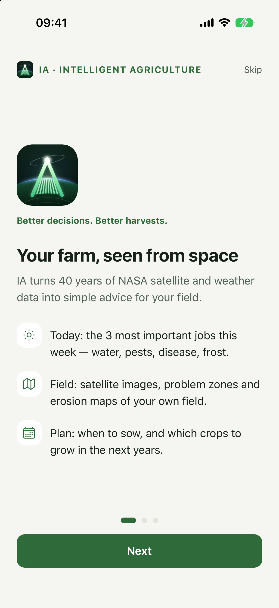
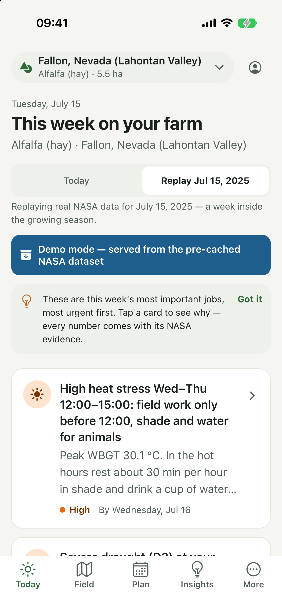
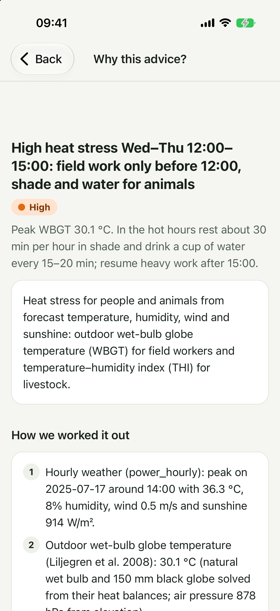
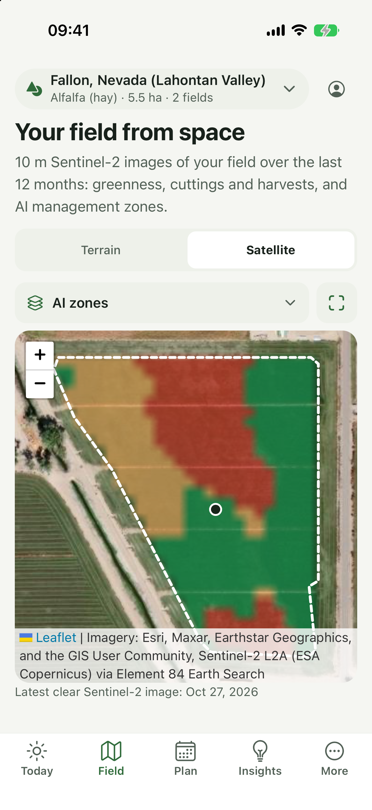
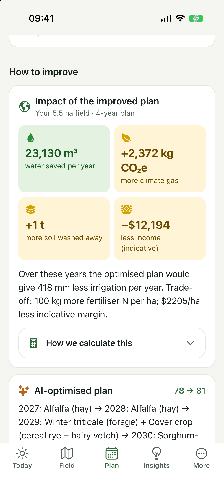
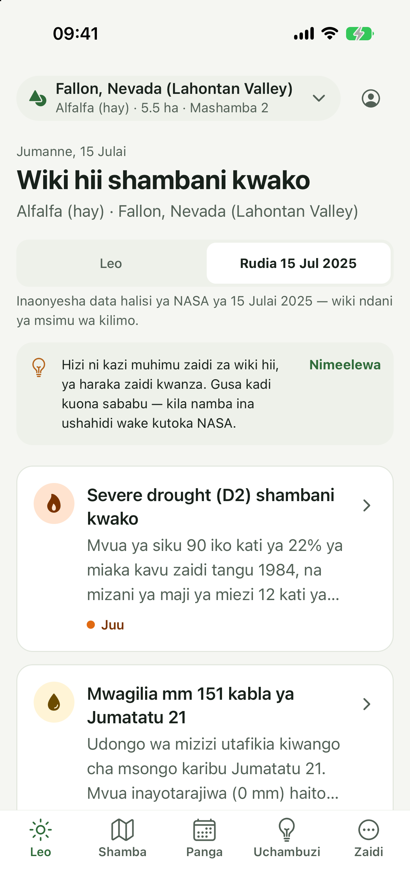
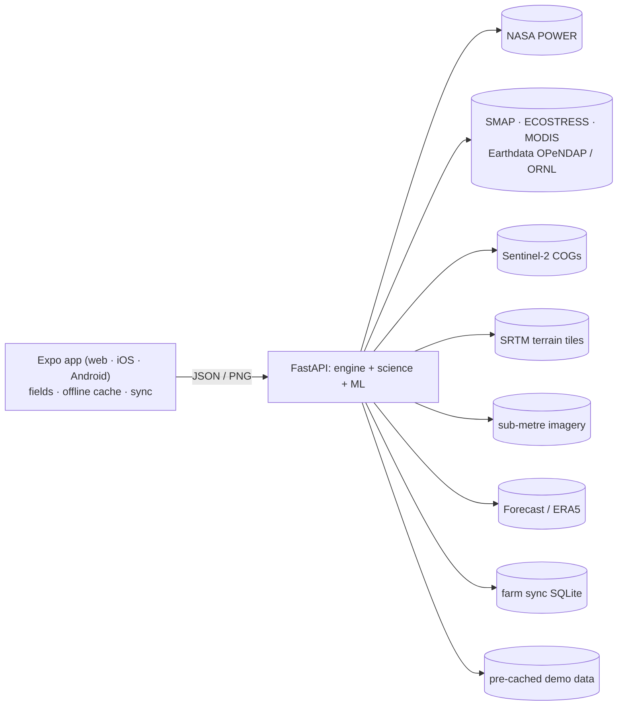

<picture><source srcset="assets/logo.svg" media="(prefers-color-scheme: dark)"></picture>

# IA · Intelligent Agriculture: 40 years of NASA data, turned into this week's farm decisions

**Better decisions. Better harvests.**

**NASA Space Apps Challenge 2026 · "Field Shift: Adapting Farms with NASA Data"** · Web · iOS · Android · syncs phone ↔ PC · 6 languages · works offline

IA is a free app for farmers that turns NASA Earth observations into plain-language decisions. Open it, tap inside your field on sub-metre satellite imagery (IA finds the boundary; you can drag the corners), and it answers four questions for every field:

1. **"What should I do this week, and why?"** At most three action cards, such as *Irrigate 38 mm by Thursday*, *High stripe-rust risk from Friday: inspect leaves* or *Fall armyworm: new generation in ~4 days*. Each has a **Why?** view with the NASA data against normal, the model, its confidence, caveats and sources.
2. **"What is happening inside my field?"** 10 m Sentinel-2 greenness history with green-up, cuttings and harvests seen from space; **AI management zones**; computed terrain maps of erosion (RUSLE), wetness, frost hollows and slope.
3. **"What should I grow in the next years?"** A **multi-year rotation plan per field**. Each year is checked against cited agronomy: 30 soil-borne diseases and pests, nitrogen from legumes, bare soil and erosion, water and climate fit, across **54 crops**. IA says what to change, proposes an AI-optimised plan and shows its **impact**: water, fertiliser, CO₂e, topsoil and income, with trade-offs stated.
4. **"Is my farm ready for the climate I actually farm in?"** 40-year climate trends at the field, What-if scenarios (+°C, −rain, sowing date, irrigation) and a season planner.

It is built for real farms. **Accounts** sync phone and PC, and it works **offline**. Each week's advice fits in **two SMS** in six languages: English, Spanish, French, Swahili, Hindi and German. A **glossary** explains every term in plain words.

| Welcome | This week | Why? | Field from space | Next years: impact | Swahili |
|---|---|---|---|---|---|
|  |  |  |  |  |  |

iPhone 17 simulator, native Release build, real data (`app/scripts/capture-film-ios.sh`). More iPhone screens: [plan](media/iphone-plan-years.png), [insights](media/iphone-insights.png), [climate](media/iphone-climate.png), [field editor](media/iphone-field-editor.png), [account](media/iphone-account.png), [Hindi](media/iphone-home-hi.png), [Spanish](media/iphone-home-es.png), [Kenya terrain zones](media/iphone-terrain-ke.png), [Kenya this week](media/iphone-home-ke.png).

More:
- web: [terrain zones](media/web-map-mobile.png), [layers](media/web-layers-mobile.png), [field editor](media/web-fields-desktop.png), [insights](media/web-insights-mobile.png), [account](media/web-account-mobile.png), [share as text](media/web-share-text-mobile.png);
- [iOS](media/) and [Android](media/) captures and [`media/BUILDS.md`](media/BUILDS.md);
- the **30 s video** [`media/ia-demo-30s.mp4`](media/ia-demo-30s.mp4) and **7-slide deck** [`media/ia-deck.pdf`](media/ia-deck.pdf);
- a static showcase site with no login: `python3 scripts/build_site.py` → `site/dist/` (GitHub Pages-ready).

## The story: Lahontan Valley, Nevada
The challenge photo shows a Nevada alfalfa farmer, so IA's hero demo is a real ~5.5 ha border-irrigated alfalfa field near Fallon. The NASA POWER record there shows:
- **days ≥ 35 °C** rising from **26 to 50 a year** since 1984;
- **warm-season rain** falling from **95 to 55 mm**;
- **July crop water demand of ~220 mm against 7 mm of rain**.

IA turns that into action:
- **Weekly:** when and how much to irrigate. In the July 2025 replay: "Irrigate … mm by Sun 20 · moderate drought (D1)".
- **Season:** five alfalfa cuttings, the first in late May; a 1,100 mm water allocation covers ~73 % of full need, so the plan shows where to cut.
- **Strategy:** **split-season alfalfa** saves ~45 % of the water at a cost in income; a **teff → winter wheat** break disrupts pest cycles.

The same engine serves a rain-fed smallholder in **Machakos, Kenya** (in Swahili), rain-fed wheat in **Córdoba, Spain**, and corn–soy in **Iowa**.

## How NASA (and partner) data drives every feature
| Data | What IA computes from it |
|---|---|
| **NASA POWER** daily agroclimatology, 1984→now | FAO-56 Penman–Monteith ET₀ → daily root-zone water balance → irrigation timing and amount. Crop stages and pest degree-days. SPI/SPEI and AI-drought features. 40-year climate trends. Every simulated season (rotations, What-if, planner). RUSLE rain erosivity |
| **NASA POWER hourly** | Disease infection-risk models (Hutton late blight, stripe rust, …) in replay/back-tests |
| **SMAP** L4 (NSIDC cloud OPeNDAP, Earthdata Login) | Root-zone soil-moisture percentile in the drought status; satellite-vs-model soil-water check; validation of the water balance (V3) |
| **GPM IMERG** Late/Early and **GRACE-FO data assimilation** (NASA GES DISC via Giovanni) | Near-real-time rain for the weeks IMERG Final has not reached (V13b); weekly groundwater percentile next to the GRACE trend |
| **ECOSTRESS** 70 m ET (LP DAAC) | Field-scale ET shown next to the model's crop ET (V6) |
| **MODIS** NDVI / ET / LST | Vegetation-condition index; NDVI anomaly → "scout this field"; ET cross-check |
| **SRTM** (NASA) elevation | Slope, wetness index, frost-prone hollows, RUSLE LS, management zones |
| **NASA GIBS** | MODIS true-colour / NDVI layers |
| **Copernicus Sentinel-2** (ESA partner data) | 10 m field NDVI series, phenology, AI zones, satellite crop coefficient fused into the water balance |
| ERA5 / ERA5-Land, U.S. Drought Monitor | Validation and ML training labels |

Licences, latencies and resolutions: [`docs/DATA.md`](docs/DATA.md).

## AI and advanced algorithms (all explainable, all validated)
- **AI drought classifier.** Gradient-boosted trees trained on 83,600 weekly U.S. Drought Monitor maps from 80 counties, with NASA POWER features. **On counties it never saw** it beats the rule-based baseline: within ±1 category 88.9 % vs. 86.2 %, Spearman 0.68 vs. 0.55, D1+ detection 70 % vs. 45 % (EXP-09).
- **Tap-to-detect field boundaries.** Field-scale graph segmentation plus edge-aware region growing on sub-metre imagery returns an editable polygon in ~1 s (EXP-10).
- **Rainy-season onset and false-start advisor.** Uses the Sivakumar/Stern onset rule and a water-balance season end on 40 years of NASA rain. Validated against IMD normals (India, MAE 3.6 days) and Sivakumar's Sahel stations (season length, MAE 12.5 days). V9.
- **Global yield calibration.** Calibrated against FAOSTAT yields in 41 countries with leave-one-country-out validation (RMSLE 0.84 → 0.50). V10.
- **Learned field-edge model.** A 1 MB U-Net running in pure numpy, plus a candidate selector, trained on the open Fields of The World dataset. On 20 held-out countries, mean IoU rose from 0.24 to 0.52. V15.
- **Global pest and disease models.** Leaf wetness after Sentelhas; BLASTAM rice blast; Magarey rust infection; Wallin tropical late blight; coffee rust, Sigatoka and desert locust. Validated against documented outbreaks, misses included. V11.
- **GPM IMERG rain blend and GRACE/GRACE-FO water storage.** The blend beats POWER alone at 16 of 18 rain gauges. GRACE agrees with groundwater wells in 11 of 11 U.S. aquifer regions. V13, V14.
- **Heat stress (WBGT, Liljegren) and livestock THI, solar pump sizing, NASA FIRMS fires.** V12.
- **AI management zones.** k-means on 10 m Sentinel-2 NDVI time series plus terrain, with k chosen by silhouette score, ranked zones and agronomic advice.
- **Satellite–model data fusion.** Observed canopy (Sentinel-2 NDVI → FAO-56 Kcb) corrects the modelled crop water use.
- **Satellite phenology.** Savitzky–Golay smoothing plus TIMESAT-style green-up, peak and senescence; bare-soil periods; double-crop and cutting detection.
- **Process models:** FAO-56 water balance, thermal-time phenology, FAO-33 yield response, RUSLE erosion, D8 flow routing and TWI, SPI/SPEI, Theil–Sen + Mann–Kendall trends.

Equations and references: [`docs/MODELS.md`](docs/MODELS.md).

**Validation** against independent data ([`docs/VALIDATION.md`](docs/VALIDATION.md)):
- ET₀ vs. ERA5: monthly r up to 0.997.
- Water balance vs. ERA5-Land and NASA SMAP L4 (median per-season r 0.64–0.92, V3). Field ET vs. ECOSTRESS disagrees at the Fallon alfalfa field and is reported as such (V6).
- Drought vs. USDM.
- The documented droughts of 2012 and 1988 come out as the two worst of 40 simulated Iowa seasons.

Weak spots are reported, not hidden.

## Architecture

Details: [`docs/ARCHITECTURE.md`](docs/ARCHITECTURE.md) · API: [`docs/API.md`](docs/API.md) · decisions: [`docs/DECISIONS.md`](docs/DECISIONS.md)

## Quickstart (one command)
```bash
docker compose up --build
# app → http://localhost:8080   ·   API docs → http://localhost:8080/docs
FIELDSHIFT_OFFLINE=1 docker compose up --build   # offline demo from the pre-cached NASA dataset
```
Mobile builds and development setup: [`docs/DEPLOYMENT.md`](docs/DEPLOYMENT.md), [`docs/DEV_ENVIRONMENT.md`](docs/DEV_ENVIRONMENT.md), [`media/BUILDS.md`](media/BUILDS.md). User guide: [`docs/USER_GUIDE.md`](docs/USER_GUIDE.md).

## Links
- App: run locally with Docker using the quickstart above. The public showcase contains the video and slides.
- Showcase: https://intelligent-agriculture-labs.github.io/
- Demo video (30 s): [watch online](https://intelligent-agriculture-labs.github.io/assets/ia-demo-30s.mp4) · [source file](media/ia-demo-30s.mp4)
- Slides: [view online](https://intelligent-agriculture-labs.github.io/deck.html) · [PDF](media/ia-deck.pdf)

## Honest limitations
- Weather grids are coarse (~50 km).
- Field irrigation history is assumed unless the farmer logs it.
- GPM IMERG rain is blended in only between 45° S and 45° N, where gauges validated it. GRACE/GRACE-FO water storage is regional (~300 km) context, not the groundwater under one field.
- Yields are water-limited potentials.
- Terraced plots may need manual outline edits.
- The Esri basemap is for this non-commercial demo.

See [`docs/LIMITATIONS.md`](docs/LIMITATIONS.md). IA supports, and does not replace, farmer judgement and local agronomic advice.

## Team
Team IA: Lino Brendler (team owner). Built for the NASA Space Apps Challenge 2026.

## Use of Super Intelligence (SI) tools (disclosure)
This project was built with substantial help from SI (AI) tools, as the Space Apps rules require us to disclose:
- An SI coding assistant (Anthropic Claude, in Claude Code / T3 Code) wrote most of the source code, tests and documentation.
- It also did the data-source research and ran the validation and ML-training experiments.
- The team defined the goals and product direction and reviewed the results.

The in-app AI components (drought classifier, k-means zones, boundary detection) are classical machine-learning and computer-vision models trained or run on open data. No generative SI produces advice at runtime. No generative image, video, voice or music models are used. The demo film (`video/`) and its score were programmed with the SI coding assistant, and the end card states this. The film shows real app screens, NASA imagery and data, and music synthesised by code. Any SI-generated media added later will carry a visible watermark and be labelled, per the rules.

## License and attributions
Code: [Apache-2.0](LICENSE).

Data:
- NASA POWER (NASA LaRC);
- NASA SMAP L4 (GMAO / NSIDC), ECOSTRESS and MODIS (LP DAAC, ORNL DAAC), GPM IMERG Late/Early and GRACE-FO data assimilation (GES DISC);
- NASA/USGS SRTM via AWS Terrain Tiles; NASA GIBS;
- Copernicus Sentinel-2 (ESA) via Element 84 Earth Search;
- Esri World Imagery (Esri, Maxar, Earthstar Geographics); USDA NAIP;
- EOX Sentinel-2 cloudless (CC BY-NC-SA 4.0);
- ISRIC SoilGrids (CC BY 4.0);
- Open-Meteo (CC BY 4.0), incl. ECMWF IFS and Copernicus ERA5;
- U.S. Drought Monitor (NDMC/USDA/NOAA); U.S. Census Gazetteer;
- FAO-56/FAO-33.

Map data © OpenStreetMap contributors.
