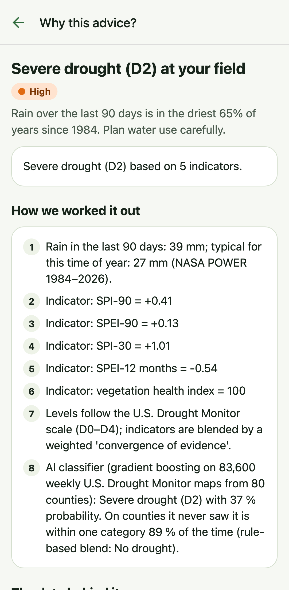
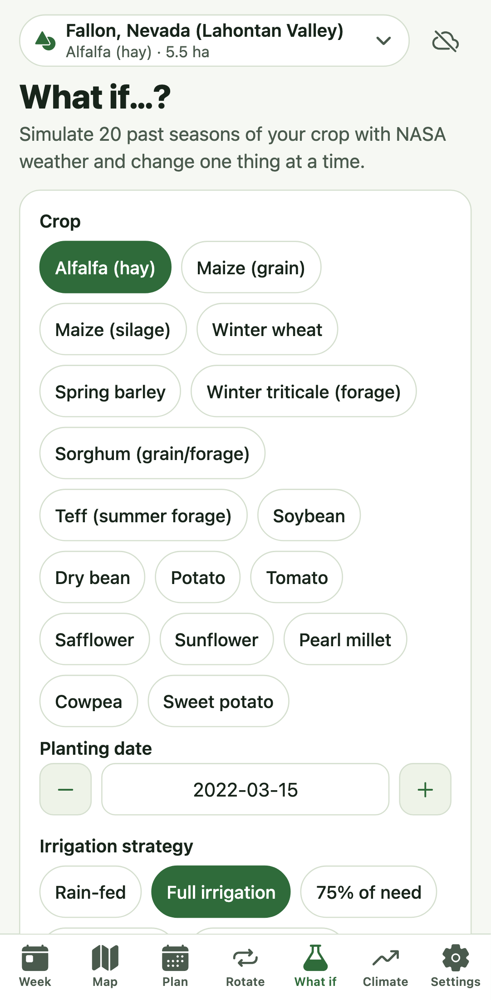
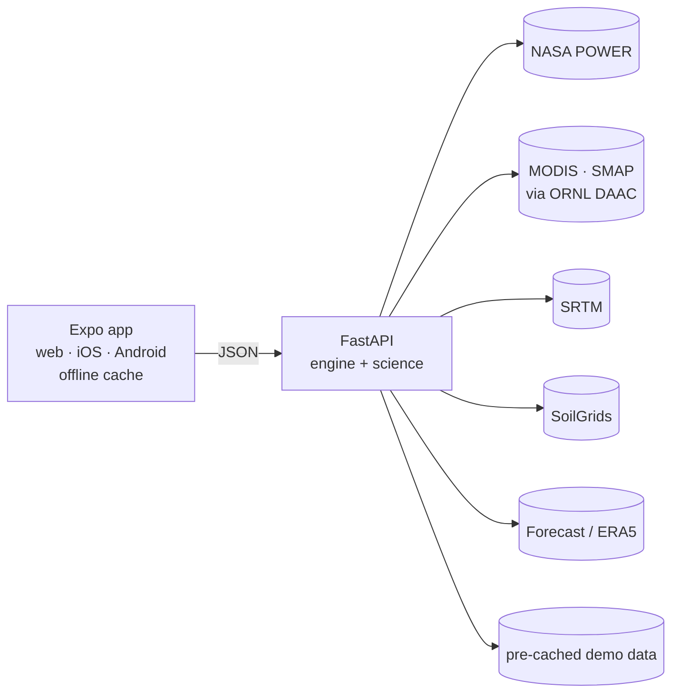

# FieldShift: 40 years of NASA data, turned into this week's farm decisions

**NASA Space Apps Challenge 2026 · "Field Shift: Adapting Farms with NASA Data"** · Web · iOS · Android · 6 languages · works offline

FieldShift answers the two questions every farmer has:

1. **"What should I do on my farm this week, and why?"** It shows at most three ranked action cards: *Irrigate 38 mm by Thursday*, *High stripe-rust risk from Friday: inspect leaves*, *Fall armyworm: scout weekly*.
2. **"Is my rotation ready for the climate I actually farm in?"** It compares the current crop rotation with ≥ 3 alternatives, each simulated on the last 15 seasons of NASA weather *at that exact field*. They are scored on water, income, soil health, erosion, pest cycles and climate risk. Each comes with why it was suggested, the evidence, the benefits, the information gaps and what needs local review.

Every number is one tap away from its evidence. The **Why?** view shows:
- the NASA time series against the 30-year normal;
- the model and its equations;
- a confidence rating with the reason for it;
- honest caveats ("SMAP's pixel is 9 km; your field is 2 ha");
- each source with its resolution, latency and last date.

| This week | Why? | Field Shift (rotations) | What if? |
|---|---|---|---|
|  |  |  |  |

> Screenshots from the web build; iOS and Android captures are in [`media/`](media/) ([`media/BUILDS.md`](media/BUILDS.md)).

## The story: Lahontan Valley, Nevada
The challenge photo shows a Nevada alfalfa farmer, so FieldShift's hero demo is irrigated alfalfa near Fallon. The NASA POWER record for that field shows:
- **days ≥ 35 °C** rising from **26 to 50 a year** since 1984;
- **warm-season rain** falling from **95 to 55 mm**;
- **July crop water demand of ~220 mm against 7 mm of rain**.

FieldShift's season model, driven by these NASA data, shows the trade-off: **split-season alfalfa** (stop irrigating after mid-July) cuts irrigation by roughly 45 % at a cost in income. A short **teff → winter wheat** break improves pest-cycle disruption. In the July 2025 replay, the weekly view tells the grower when to irrigate and by how much, and that the farm is in **moderate drought (D1)**. The same engine runs for rain-fed smallholders in **Machakos, Kenya**, rain-fed wheat in **Córdoba, Spain** and corn–soy in **Iowa**.

## How NASA data is used (not decoration: every model runs on it)
| NASA data | What FieldShift computes from it |
|---|---|
| **NASA POWER** daily agroclimatology, 1984→now (T, humidity, wind, solar radiation, MERRA-2 bias-corrected rain) | FAO-56 Penman–Monteith ET₀ → daily root-zone water balance → irrigation timing and amount. Growing-degree-days → crop stages and pest life stages. SPI/SPEI drought indices. 40-year climate trends. Every simulated season in the rotation explorer and What-if |
| **NASA POWER hourly** | Disease infection-risk models (late blight Hutton criteria, stripe rust, …) in replay/back-tests |
| **SMAP** L3 enhanced soil moisture (9 km) | Soil-moisture percentile in the drought status |
| **MODIS** MOD13Q1 NDVI (250 m), MOD16 ET, MOD11 LST | Vegetation-condition index; NDVI anomaly → "scout this field" card; ET cross-check |
| **SRTM** 30 m elevation | Slope → erosion index for rotations; elevation → psychrometric constant |
| **NASA GIBS** | MODIS true-colour / NDVI imagery on the field map |

Partner and open data:
- ERA5 / ERA5-Land (Copernicus/ECMWF) for validation;
- the Open-Meteo forecast for the next 16 days;
- ISRIC SoilGrids for soil water capacity;
- the U.S. Drought Monitor for validation;
- FAO-56 / FAO-33 crop parameters.

Full table with latencies and licences: [`docs/DATA.md`](docs/DATA.md).

## Scientific depth
- **Season model:** FAO-56 single-Kc root-zone water balance, thermal-time phenology calibrated per location, FAO-33 yield response, heat and frost penalties, and irrigation strategies (full, deficit, allocation, split-season). See [`docs/MODELS.md`](docs/MODELS.md).
- **Validation** against independent references ([`docs/VALIDATION.md`](docs/VALIDATION.md)):
  - ET₀ vs. ERA5: monthly r = 0.91–0.997 at 4 sites;
  - soil-water dynamics vs. ERA5-Land: median r ≈ 0.7 in temperate sites;
  - drought status vs. the U.S. Drought Monitor: ρ = 0.74 at Ames;
  - documented drought years: Iowa 2012 = worst and 1988 = 2nd-worst of 40 simulated seasons;
  - weak spots, such as Kenya soil water and Nevada's snowpack-driven drought, are reported, not hidden.
- **Experiments that changed the code:** [`docs/EXPERIMENTS.md`](docs/EXPERIMENTS.md). Examples: adding a 12-month SPEI raised USDM agreement; late-frost logic fixed a yield collapse.

## Architecture

Details: [`docs/ARCHITECTURE.md`](docs/ARCHITECTURE.md) · API: [`docs/API.md`](docs/API.md) · decisions: [`docs/DECISIONS.md`](docs/DECISIONS.md)

## Quickstart (one command)
```bash
docker compose up --build
# app → http://localhost:8080   ·   API docs → http://localhost:8000/docs
FIELDSHIFT_OFFLINE=1 docker compose up --build   # fully offline demo from the pre-cached NASA dataset
```
Without Docker, and for the mobile builds, see [`docs/DEV_ENVIRONMENT.md`](docs/DEV_ENVIRONMENT.md) and [`docs/DEPLOYMENT.md`](docs/DEPLOYMENT.md). User guide: [`docs/USER_GUIDE.md`](docs/USER_GUIDE.md).

## Links
- Live demo: *not publicly hosted yet* (see [`docs/DEPLOYMENT.md`](docs/DEPLOYMENT.md#public-hosting-human-step))
- Demo video and slides: see [`SUBMISSION.md`](SUBMISSION.md)
- Builds: [`media/BUILDS.md`](media/BUILDS.md)

## Honest limitations
- Data grids are coarse (POWER ~50 km).
- Field irrigation history is assumed.
- No Earthdata-only products (IMERG, GRACE-FO) yet.
- Yields are water-limited potentials.

See [`docs/LIMITATIONS.md`](docs/LIMITATIONS.md). FieldShift supports, and does not replace, farmer judgement and local agronomic advice.

## Team
FieldShift team: Lino Brendler (team owner). Built for the NASA Space Apps Challenge 2026.

## Use of Super Intelligence (SI) tools (disclosure)
This project was built with substantial help from SI (AI) tools, as the Space Apps rules require us to disclose:
- An SI coding assistant (Anthropic Claude, in Claude Code / T3 Code) wrote most of the source code, tests and documentation.
- It also did the data-source research and ran the validation experiments.
- The team defined the goals and reviewed the results.

All scientific methods are published, cited methods (FAO-56, FAO-33, SPI/SPEI, Hutton criteria, …). Every number shown in the app is computed from data by deterministic code; no SI generates advice text at runtime. No SI-generated images or video are used. Any that are added later will carry a visible watermark and be labelled, per the rules.

## License and attributions
Code: [Apache-2.0](LICENSE).

Data:
- NASA POWER (NASA LaRC);
- NASA SMAP, MODIS (LP DAAC / NSIDC via ORNL DAAC);
- NASA/USGS SRTM; NASA GIBS;
- ISRIC SoilGrids (CC BY 4.0);
- Open-Meteo (CC BY 4.0), incl. ECMWF IFS and Copernicus ERA5;
- U.S. Drought Monitor (NDMC/USDA/NOAA);
- FAO-56/FAO-33.

Map tiles © OpenStreetMap contributors.
