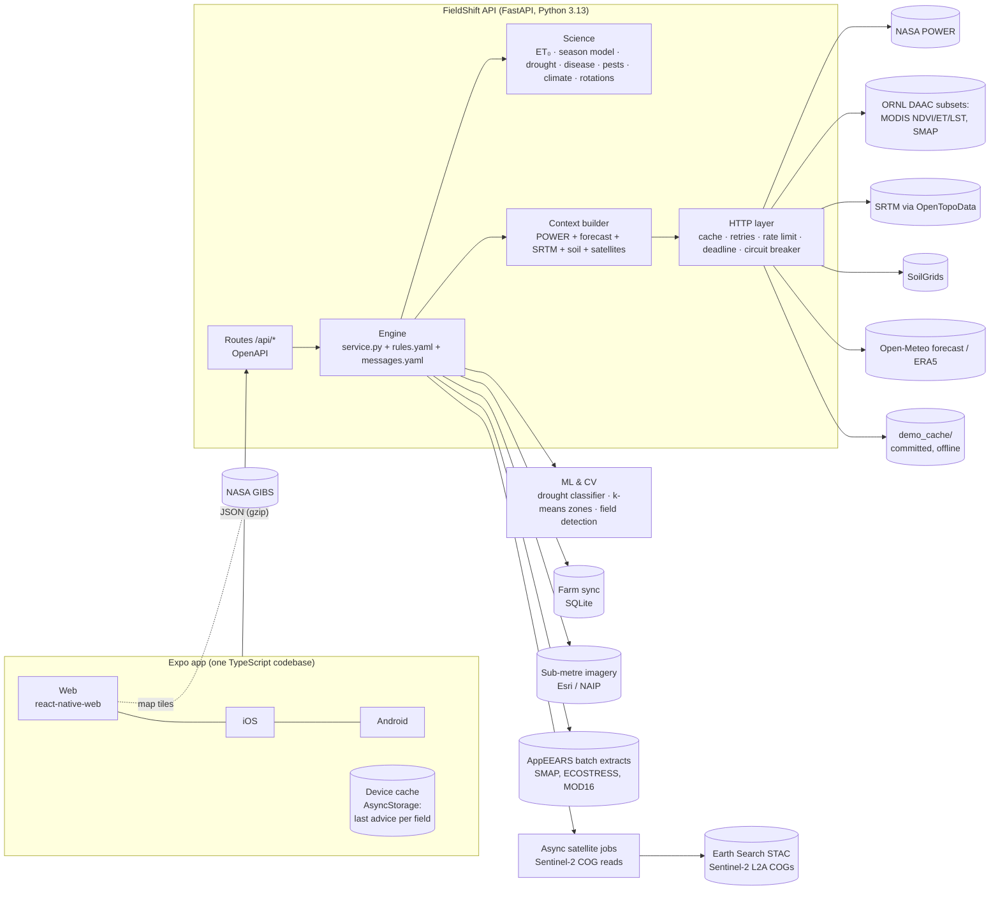

# Architecture



## Request flow: `POST /api/advice`
1. **Context.** `engine/context.build(lat, lon, as_of)` assembles one daily weather record:
   - NASA POWER from 1984 → latest;
   - the Open-Meteo past 14 days bridge POWER's latency;
   - 16 forecast days on top.
   Each day carries a provenance flag (observed, bridge or forecast). Elevation and slope come from SRTM, soil from SoilGrids. In replay mode (`as_of` in the past), later POWER days act as a perfect forecast, and hourly T/RH come from POWER hourly.
2. **Satellite enrichment** runs in parallel with a timeout: MODIS NDVI, MOD16, SMAP and LST from ORNL. If it is slow, advice goes out without those layers, and the sources list says "unavailable".
3. **Modules.** These produce cards:
   - season water balance → irrigation or water-stress card;
   - SPI/SPEI/SMAP/VHI → drought card;
   - hourly disease models → disease cards;
   - degree-days → pest cards;
   - forecast extremes → frost and heat cards;
   - NDVI anomaly → scouting card;
   - season state → off-season rotation-planning card.
4. **Ranking and response.** Cards are ranked by risk, then due date. Each carries a Why block. The response also has the time series for the charts, the sources with status and last date, a `mock` flag (always false) and an `offline` flag.

## Field mapping and satellite analytics
- `POST /api/fields/detect`: fetches sub-metre tiles around the tap, runs field-scale segmentation and returns an editable polygon (~1 s).
- `POST /api/satellite` (asynchronous):
  1. STAC search, then parallel windowed COG reads (red/NIR/SCL) onto a mercator grid matching the map.
  2. Cloud masking.
  3. NDVI series, phenology and harvest events.
  4. k-means zones (with terrain sampled onto the same grid) and satellite Kcb.
  5. PNG overlays.
  6. Results cached as JSON on disk.
  The client polls until done. Advice reuses a cached analysis for data fusion (Kcb → water balance).
- `POST/PUT/GET /api/farms`: account-free sync. Each device keeps a farm id; fields merge per id by `updated_at`.

## Rotation explorer: `POST /api/rotations`
The context comes first, then 1991–2020 normals. Next, each unique crop slot is simulated over 15 seasons, with results cached per crop, planting date and irrigation cut-off within the request. Then the feasibility filter, metrics and priority-weighted scores, and finally the current rotation plus the top 4 alternatives with their texts. Runtime is ~1–3 s on a warm cache.

## Deployment shape
One image (root `Dockerfile`). Stage 1 exports the Expo web bundle; stage 2 is the FastAPI app, which serves `/api/*`, `/docs` and the static web app with SPA fallback. A single container avoids inter-container DNS (which failed on the podman test host) and makes hosting trivial.

## Why this shape
- **Point time series instead of rasters.** A farmer asks about one field. Point APIs (POWER, ORNL subsets, Open-Meteo) return 40 years for a location in one request. Payloads stay small (advice ≈ 20 KB gzipped), so there is no raster store to operate.
- **Config over code.** Crop parameters, rotation templates, rules/thresholds and texts are versioned YAML (`config/`), and changes are logged in DECISIONS.md.
- **One engine, four views.** This week, Rotations, What-if and Climate all call the same season model, so numbers are consistent across screens.
- **Offline by construction.** The HTTP layer's cache doubles as the offline dataset. The client keeps the last response per field.

## Repository layout
```
backend/            FastAPI app (fieldshift/), tests/, demo_cache/, Dockerfile
  fieldshift/data/      http.py (cache/fallbacks), sources.py (adapters)
  fieldshift/science/   et0, soil, cropmodel, drought, drought_ml, disease, pests, climate, rotation, terrain, satellite, fielddetect
  fieldshift/models/    trained drought classifier (joblib + metadata)
  fieldshift/engine/    context, service, messages, maps (terrain), planner, satellite_service, fields (detect), farms (sync)
  fieldshift/config/    crops.yaml, rotations.yaml, rules.yaml, messages.yaml, presets.yaml
app/                Expo client (src/app = routes, src/components, src/i18n, src/api), e2e/, Dockerfile
contracts/api.ts    API contract shared by client and server
scripts/            build_demo_cache.py, validate.py, validation_report.py, train_drought_ml.py, appeears_smap.py (SMAP/ECOSTRESS/MOD16), make_demo_video.py
docs/               all documentation, validation figures, openapi.json
media/              screenshots, screen recordings, build notes
```
