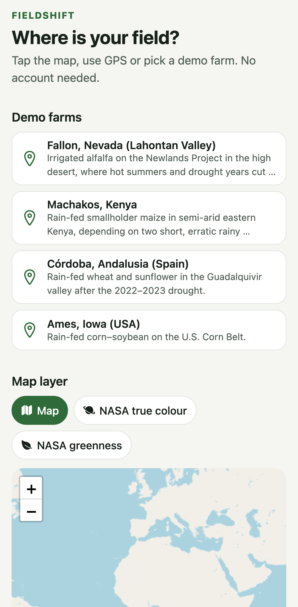
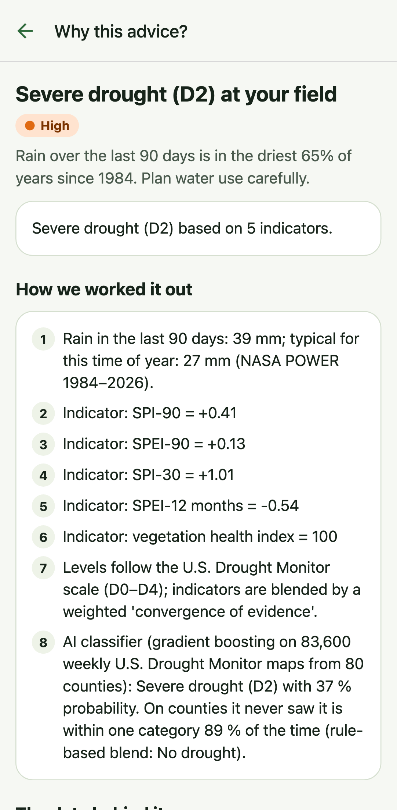
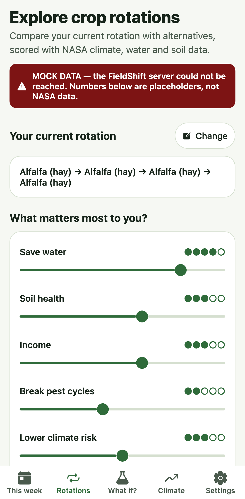

# FieldShift user guide

FieldShift tells you what to do on your farm this week, and helps you plan next season's rotation. It uses NASA satellite and weather data for your exact location. No account is needed.

## 1. Set up your field (under a minute)

1. **Where is your field?** Tap the map, press **Use my GPS**, or type coordinates. You can also tap a **demo farm** (Nevada, Kenya, Spain or Iowa) to try the app.
2. **Optional:** tap **Outline field** and tap the corners of your field to get its area.
3. **Crop:** pick what you grow.
4. **Planting date:** when you sowed. For alfalfa and other perennials, use the spring green-up date.
5. **Irrigation:** none (rain-fed), drip, sprinkler, centre pivot, furrow or flood.
6. Press **Show my advice**.
 

## 1b. Your fields, on every device
- **Add a field:** open the field switcher at the top → **Add field**.
- **Detect field automatically:** zoom in on the high-resolution satellite image and **tap inside your field**. FieldShift finds the boundary in a second or two and shows its area and a confidence badge.
- **Fix it by hand:** drag a corner, tap the small handle in the middle of an edge to add a corner, or remove a corner. You can also draw the outline yourself, corner by corner.
- **Many fields:** switch fields at the top of every screen. Each field has its own crop, sowing date, irrigation and water allocation.
- **Phone and computer in sync:** Settings → **Sync across devices** → **Enable sync** shows a farm code (e.g. `K7QF-2M9X`) and a QR code. On the other device, choose **Join a farm** and enter the code or scan the QR. Fields, irrigation logs and settings then stay in sync. No account or e-mail is needed; keep the code private.

## 2. This week

- Up to **3 action cards**, most urgent first. The colour is the risk: green = low, yellow = moderate, orange = high, red = severe.
- Each card says *what* to do and *by when*, e.g. "Irrigate 38 mm by Thu 16".
- **Drought:** your drought level (D0–D4, like the U.S. Drought Monitor) from NASA rain records, SMAP soil moisture and MODIS vegetation health.
- **Water:** how much of the soil water your crop has already used, the rain and crop water demand for the next 7 days, and season totals.
- **Demo farms only:** switch between **Today** and **Replay** (a real week inside the growing season) to see how advice looks mid-season.
- Pull down to refresh. Without internet, the last advice is shown with an "Offline" note.
 

## 3. Why? (tap any card)

- **In short:** a plain-language explanation.
- **How we got there:** each step with the actual numbers.
- **Charts:** the data behind the advice. Dashed lines show the normal for this time of year, and shading marks forecast days.
- **Confidence:** how sure FieldShift is, and why.
- **Keep in mind:** limits of the data. For example, satellite pixels can be larger than your field.
- **Data sources:** which NASA or partner dataset was used, its resolution, latency and last date.
 

## 3b. Map
The **Map** tab shows your field on a satellite or NDVI background (NASA GIBS), with maps computed from elevation data:
- **Elevation & relief**
- **Slope**
- **Erosion risk:** estimated soil loss in t/ha/yr, using NASA rain records and your crop.
- **Wetness:** where water collects.
- **Frost-prone hollows**
- **Management zones:** all of the above combined.

Below the map, **Planning advice for your field** lists each zone, how much of your field it covers, and what to do about it. Example: "Erosion hotspot, 32 %: keep soil covered, farm along the contour". Draw your field outline during setup for exact numbers.

## 3b-2. Your field from space (Map → Satellite)
FieldShift reads every clear **Sentinel-2** image of your field from the past year (10 m pixels) and shows:
- the **latest true-colour and greenness (NDVI) image** of your field;
- a **greenness curve** across the season, with green-up, peak, ripening, bare-soil periods and **cuttings/harvests seen from space**;
- **AI management zones**: parts of the field that consistently grow better or worse, with what to check in each (waterlogging, slope, soil sampling, variable seeding);
- the **satellite crop coefficient**: how much water your actual canopy uses. The irrigation advice uses it automatically.

The first analysis of a new field takes a little while; after that it opens instantly, and offline too.

## 3c. Plan
The **Plan** tab is your season planner:
- the best **sowing window**, from a chart of yield against sowing date (a typical year and a bad year);
- a **timeline** of the season: sowing, crop stages (with how much they vary between years), when to scout for pests, the peak irrigation month and harvest (for alfalfa, the cutting dates);
- a **monthly water budget**: crop water use against rain and irrigation. If you enter your seasonal water allocation, it shows how much of the need it covers;
- a **risk calendar**: the chance of damaging frost or heat in each month.

## 4. Rotations (Field Shift)

1. Check **Your current rotation**, and press **Change** to edit it (one crop per year).
2. Use the sliders to say **what matters most**: saving water, soil health, income, breaking pest cycles, lower climate risk.
3. Press **Update comparison**. FieldShift simulates your rotation and alternatives over the last 15 seasons of NASA weather at your field.
4. For each strategy you see:
   - a score;
   - bars comparing it with your current rotation;
   - a month-by-month **calendar** where pale cells mean bare soil;
   - **why it was suggested**, the **evidence**, the **benefits**, **what we don't know**;
   - **what to check locally** (markets, water rights, herbicide carry-over…).

Prices are indicative national values. Always check your local market.
 

## 5. What if?
Change the crop, sowing date, irrigation strategy (full, 75 % / 50 % deficit, seasonal allocation), temperature (+°C) or rain (%). You see the yield in a typical, bad (1-in-10) and good year, the irrigation water, the stress days and the chance of a failed season, compared with your baseline. Use it to compare options, not to predict an exact harvest.

## 6. Climate
See how your local season has changed since 1984 in NASA POWER data: heat days, frost-free season, rain, crop water demand and dry spells. Each trend shows its rate per decade, and FieldShift only calls a trend "clear" when it is statistically significant.

## 7. Settings
- **Language:** English, Español, Français, Kiswahili, हिन्दी, Deutsch.
- **Units:** metric (mm, °C, ha) or imperial (in, °F, ac).
- **Expert mode:** raw data tables, CSV and GeoJSON export, methodology links.

## Good to know
- FieldShift supports your decisions. It does not replace your experience or your local adviser.
- Weather data covers about 50 km. Frost hollows, hills and lakes can make your field differ.
- If you enter your last irrigation date and amount, the water advice becomes more precise.
