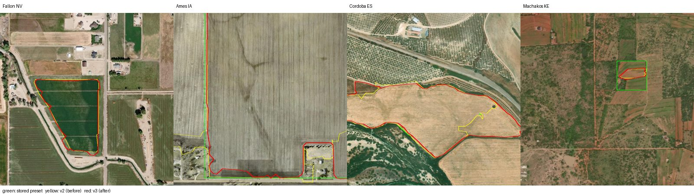

# Validation

Every FieldShift output that drives advice is compared with an **independent** reference. Tables are generated from `docs/validation/results.json` by `scripts/validation_report.py`, after running `scripts/validate.py` on the data box. The numbers below therefore match the code at the time of the run. Figures (`docs/validation/*.png`) are produced by the same run.

How to read this page:
- Good agreement means the inputs and physics are sound. It does **not** prove the advice is right on a given field: the references are themselves models or coarse data.
- Weak results are kept and explained.

<!-- RESULTS:BEGIN -->
### V1 · Reference ET₀ (FieldShift FAO-56 PM from NASA POWER) vs. ERA5 FAO-56 ET₀, daily 2015–2024
_run: 2026-11-14T18:26:34+00:00_

| Site | n days | daily r | daily RMSE (mm/d) | daily bias (mm/d) | monthly r | monthly bias (mm/mo) |
|---|---|---|---|---|---|---|
| Fallon, NV | 3653 | 0.97 | 0.78 | -0.48 | 0.996 | -14.6 |
| Ames, IA | 3653 | 0.96 | 0.53 | -0.14 | 0.988 | -4.1 |
| Córdoba, ES | 3653 | 0.98 | 0.49 | 0.01 | 0.997 | 0.3 |
| Machakos, KE | 3653 | 0.86 | 0.77 | 0.56 | 0.905 | 16.9 |

### V2 · Rain-fed root-zone water (1 − Dr/TAW) vs. ERA5-Land 7–100 cm soil moisture
_run: 2026-11-14T18:26:35+00:00_

| Site | crop | seasons | median r per season | pooled standardized r |
|---|---|---|---|---|
| Ames, IA | maize | 9 | 0.71 | 0.58 |
| Córdoba, ES | winter_wheat | 9 | 0.73 | 0.72 |
| Machakos, KE | maize | 9 | 0.49 | 0.30 |

### V3 · Rain-fed root-zone water vs. NASA SMAP L4 root-zone soil moisture (0–100 cm)
_Pending at v1.0.0: the NASA AppEEARS point-extraction requests for this check (submitted 14 Nov 2026) were still queued or processing at NASA when the release was cut. `scripts/appeears_smap.py` and `scripts/validate.py` reproduce it once they finish. No result is claimed until then._

### V4 · Drought status vs. U.S. Drought Monitor (weekly 2005–2024, county DSCI)
_run: 2026-11-14T18:28:15+00:00_

| County | weeks | ρ SPI-90 | ρ SPEI-90 | ρ SPEI-12 | ρ status v1 | ρ status v2 (used) | D1 hit rate v2 | D1 false-alarm ratio v2 |
|---|---|---|---|---|---|---|---|---|
| Fallon, NV | 1045 | 0.14 | 0.29 | 0.67 | 0.22 | 0.38 | 0.42 | 0.25 |
| Ames, IA | 1045 | 0.63 | 0.70 | 0.65 | 0.66 | 0.74 | 0.68 | 0.37 |

### V5 · Documented drought years in simulated rain-fed yields
_run: 2026-11-14T18:28:15+00:00_

| Site / season | years simulated | documented drought year | rank (1 = worst) |
|---|---|---|---|
| Ames, IA maize | 40 | 2012 | **1** |
| Ames, IA maize | 40 | 1988 | **2** |
| Machakos, KE maize (short rains) | 34 | 2016 | **6** |
| Machakos, KE maize (short rains) | 34 | 2005 | **8** |

### V6 · Irrigated alfalfa ET at the Fallon field: model vs NASA ECOSTRESS (70 m) and MODIS MOD16 (500 m)
_run: 2026-11-14T15:44:56+00:00_

_Pending at v1.0.0: the NASA AppEEARS point-extraction requests for this check (submitted 14 Nov 2026) were still queued or processing at NASA when the release was cut. `scripts/appeears_smap.py` and `scripts/validate.py` reproduce it once they finish. No result is claimed until then._

### V7 · Late-blight weather risk (Hutton criteria, NASA POWER hourly), Ithaca NY, Jun–Aug
_run: 2026-11-14T18:28:15+00:00_

| Year | 2005 | 2006 | 2007 | 2008 | 2009 | 2010 | 2011 | 2012 | 2013 | 2014 | 2015 |
|---|---|---|---|---|---|---|---|---|---|---|---|
| Hutton days | 42 | 60 | 34 | 62 | 57 | 33 | 47 | 25 | 57 | 49 | 45 |

2009 (documented epidemic) ranks **3 of 11**.

### V8 · AI drought classifier vs. rule-based status on U.S. counties the model never saw
_trained: 2026-11-14T17:59:37+00:00 · 80 counties · 83,600 weekly USDM labels · GroupKFold(5) by county_

| Metric | AI classifier | Rule-based blend |
|---|---|---|
| Exact category | 0.610 | 0.590 |
| Within ±1 category | 0.889 | 0.862 |
| Mean abs. error (levels) | 0.536 | 0.595 |
| Spearman vs. DSCI | 0.679 | 0.548 |
| D1+ hit rate | 0.700 | 0.449 |
| D1+ false-alarm ratio | 0.389 | 0.423 |

Adopted: **True** (contiguous U.S. only).

<!-- RESULTS:END -->

### V9 · Tap-to-detect field boundaries worldwide (Fields of The World, 25 countries)
_Script: `scripts/field_benchmark.py` (sample → run → report). Experiment log: EXPERIMENTS EXP-12. Decision: ADR-020._

**Ground truth.** [*Fields of The World*](https://fieldsofthe.world/) (FTW; Kerner et al., *Fields of The World: A Machine Learning Benchmark Dataset for Global Agricultural Field Boundary Segmentation*, AAAI 2025) publishes vector field boundaries for 24 countries plus Corsica on four continents (`source.coop/kerner-lab/fields-of-the-world-<country>`). Most are government parcel registers (LPIS); Kenya, Rwanda, India, Cambodia, Vietnam and Brazil are hand-annotated. Each country keeps its source licence: CC-BY-4.0 (Austria, Brazil, Cambodia, Finland, India, Rwanda, Slovenia, Spain, Vietnam), CC0-1.0 (Denmark, Luxembourg, Netherlands, Slovakia), CC-BY-2.0 (Corsica), CC-3.0 as listed by FTW (Estonia), Licence Ouverte, IGN RPG (France), DL-DE/BY-2.0 (Germany), open-data terms (Belgium, Croatia, Sweden), CC-BY-NC-4.0 (Latvia, Portugal), non-commercial use only (Lithuania), CC-BY-NC-SA-4.0 (South Africa) and GPL-2.0-or-later (Kenya). The polygons are **not redistributed**. The repo holds only field ids and tap points (`docs/validation/field_benchmark_sample.csv`) and per-field scores (`docs/validation/field_benchmark_{before,after}.json`).

**Protocol.**
- **Sample:** 467 fields, stratified by country and size class: S < 0.5 ha, M 0.5–2, L 2–10, XL 10–150 ha. Four fields per class in each held-out country, eight in each development country; Kenya and Vietnam lack some classes. Seed 2026.
- **Taps:** one simulated tap per field, a uniformly random point at least min(10 m, 15 % of √area) inside the boundary.
- **Detector run:** the production code path (`engine.fields.detect_field`) on the imagery the app uses: Esri World Imagery, 3 × 3 tiles at zoom 17, retried at zoom 16 when the field touches the window edge.
- **Scores:**
  - IoU of the returned polygon with the FTW polygon, in local UTM.
  - Boundary F-score: share of each outline's points (every 1 m) within 5 m of the other outline.
  - A failed detection scores 0.
- **Country split (fixed before any tuning):**
  - DEV = Austria, France, India, Netherlands, Spain. Used for parameter choices and model selection. The edge model and selector were trained on open orthophotos of AT/FR/ES/NL only, never on Esri imagery and never within ~3 km of a benchmark field.
  - The other **20 countries (314 fields) are held out**: no tuning, no training, scored once.
- **Before** = v2 detector (Felzenszwalb + region growing, EXP-10). **After** = v3 (learned edge map + candidate selection, EXP-12).
- Both runs used the same cached tiles in one process; times exclude tile download.

<!-- FIELDS:BEGIN -->
**Held-out countries (never used for tuning or training)** — mean ΔIoU +0.281 (95 % bootstrap CI +0.245 … +0.318), n = 314

| Country | n | IoU before | IoU after | Δ | IoU ≥ 0.5 | boundary F (5 m) |
|---|---|---|---|---|---|---|
| Belgium (Europe) | 16 | 0.26 | **0.64** | +0.38 | 19% → 69% | 0.17 → 0.56 |
| Brazil (S. America) | 16 | 0.22 | **0.27** | +0.05 | 12% → 25% | 0.04 → 0.04 |
| Cambodia (Asia) | 16 | 0.08 | **0.33** | +0.25 | 0% → 25% | 0.02 → 0.29 |
| Corsica (Europe) | 16 | 0.32 | **0.49** | +0.17 | 31% → 44% | 0.20 → 0.43 |
| Croatia (Europe) | 16 | 0.50 | **0.60** | +0.10 | 44% → 56% | 0.46 → 0.58 |
| Denmark (Europe) | 16 | 0.30 | **0.73** | +0.43 | 19% → 81% | 0.21 → 0.62 |
| Estonia (Europe) | 16 | 0.32 | **0.58** | +0.26 | 25% → 56% | 0.17 → 0.53 |
| Finland (Europe) | 16 | 0.33 | **0.68** | +0.35 | 31% → 75% | 0.19 → 0.55 |
| Germany (Europe) | 16 | 0.17 | **0.39** | +0.22 | 12% → 38% | 0.09 → 0.31 |
| Kenya (Africa) | 12 | 0.12 | **0.36** | +0.24 | 8% → 42% | 0.05 → 0.20 |
| Latvia (Europe) | 16 | 0.17 | **0.44** | +0.27 | 0% → 44% | 0.10 → 0.37 |
| Lithuania (Europe) | 16 | 0.38 | **0.60** | +0.21 | 31% → 56% | 0.28 → 0.61 |
| Luxembourg (Europe) | 16 | 0.25 | **0.63** | +0.38 | 19% → 62% | 0.17 → 0.58 |
| Portugal (Europe) | 16 | 0.05 | **0.47** | +0.42 | 0% → 44% | 0.01 → 0.39 |
| Rwanda (Africa) | 16 | 0.11 | **0.50** | +0.39 | 12% → 50% | 0.10 → 0.43 |
| Slovakia (Europe) | 16 | 0.35 | **0.58** | +0.23 | 31% → 62% | 0.28 → 0.43 |
| Slovenia (Europe) | 16 | 0.27 | **0.56** | +0.29 | 19% → 56% | 0.18 → 0.51 |
| South Africa (Africa) | 16 | 0.34 | **0.59** | +0.25 | 31% → 69% | 0.23 → 0.42 |
| Sweden (Europe) | 16 | 0.21 | **0.51** | +0.30 | 12% → 50% | 0.14 → 0.39 |
| Vietnam (Asia) | 14 | 0.03 | **0.49** | +0.46 | 0% → 43% | 0.01 → 0.46 |
| **All** | 314 | 0.24 | **0.52** | +0.28 | 18% → 53% | 0.16 → 0.44 |

| Continent | n | IoU before | IoU after | Δ | IoU ≥ 0.5 | boundary F (5 m) |
|---|---|---|---|---|---|---|
| Africa | 44 | 0.20 | **0.49** | +0.30 | 18% → 55% | 0.13 → 0.36 |
| Asia | 30 | 0.06 | **0.40** | +0.35 | 0% → 33% | 0.02 → 0.37 |
| Europe | 224 | 0.28 | **0.56** | +0.29 | 21% → 57% | 0.19 → 0.49 |
| S. America | 16 | 0.22 | **0.27** | +0.05 | 12% → 25% | 0.04 → 0.04 |

| Size class | n | IoU before | IoU after | Δ | IoU ≥ 0.5 | boundary F (5 m) |
|---|---|---|---|---|---|---|
| S <0.5 ha | 80 | 0.13 | **0.41** | +0.28 | 10% → 45% | 0.13 → 0.44 |
| M 0.5–2 ha | 80 | 0.18 | **0.54** | +0.37 | 11% → 56% | 0.13 → 0.49 |
| L 2–10 ha | 80 | 0.30 | **0.64** | +0.34 | 26% → 65% | 0.21 → 0.49 |
| XL 10–150 ha | 74 | 0.37 | **0.49** | +0.13 | 26% → 43% | 0.16 → 0.33 |

**Development countries (used for tuning)** — mean ΔIoU +0.335 (95 % bootstrap CI +0.284 … +0.386), n = 153

| Country | n | IoU before | IoU after | Δ | IoU ≥ 0.5 | boundary F (5 m) |
|---|---|---|---|---|---|---|
| Austria (Europe) | 32 | 0.24 | **0.62** | +0.38 | 22% → 72% | 0.15 → 0.58 |
| France (Europe) | 32 | 0.33 | **0.55** | +0.23 | 28% → 59% | 0.25 → 0.46 |
| India (Asia) | 25 | 0.06 | **0.47** | +0.41 | 0% → 56% | 0.04 → 0.40 |
| Netherlands (Europe) | 32 | 0.24 | **0.61** | +0.38 | 22% → 62% | 0.15 → 0.53 |
| Spain (Europe) | 32 | 0.28 | **0.58** | +0.30 | 22% → 66% | 0.24 → 0.52 |
| **All** | 153 | 0.24 | **0.57** | +0.34 | 20% → 63% | 0.17 → 0.50 |

| Continent | n | IoU before | IoU after | Δ | IoU ≥ 0.5 | boundary F (5 m) |
|---|---|---|---|---|---|---|
| Asia | 25 | 0.06 | **0.47** | +0.41 | 0% → 56% | 0.04 → 0.40 |
| Europe | 128 | 0.27 | **0.59** | +0.32 | 23% → 65% | 0.20 → 0.52 |

| Size class | n | IoU before | IoU after | Δ | IoU ≥ 0.5 | boundary F (5 m) |
|---|---|---|---|---|---|---|
| S <0.5 ha | 40 | 0.10 | **0.38** | +0.28 | 8% → 38% | 0.11 → 0.43 |
| M 0.5–2 ha | 40 | 0.18 | **0.60** | +0.42 | 15% → 62% | 0.16 → 0.57 |
| L 2–10 ha | 40 | 0.30 | **0.69** | +0.39 | 28% → 82% | 0.22 → 0.54 |
| XL 10–150 ha | 33 | 0.39 | **0.63** | +0.24 | 30% → 73% | 0.20 → 0.47 |

Time per tap (imagery cached, one process): median 0.4 s → 0.2 s, 95th percentile 1.7 s → 1.0 s. Runs: before 2026-11-15T01:27:56Z, after 2026-11-15T02:00:15Z.
<!-- FIELDS:END -->

**Demo fields** (the four app presets; no FTW labels exist there). The stored preset outlines of Fallon and Córdoba were *produced by the v2 detector*, so IoU against them is circular (v2 scores ~1.0 by construction). The overlays were therefore also checked by eye (`docs/validation/fields_demo.jpg`).

| Field | IoU v2 vs preset | IoU v3 vs preset | Visual check |
|---|---|---|---|
| Fallon NV (5.5 ha, border-irrigated alfalfa) | 1.00 (circular) | 0.93 | Same field, both correct (5.52 vs 5.53 ha) |
| Ames IA (≈ 48 ha quarter section) | 0.88 | **0.91** | v3 follows the field edge and excludes the farmstead; v2 leaked into the farmstead |
| Córdoba ES (wheat on the Guadalquivir) | 1.00 (circular) | 0.79 | v3 is better: v2 (= the preset) cut the eastern lobe off along a jagged line through the crop; v3 follows the road and olive grove |
| Machakos KE (terraced smallholding; preset = rough rectangle) | 0.22 | 0.24 | Both return one terrace strip of ~0.55 ha (still the known weakness) |

## Interpretation

### Where the models are strong
- **ET₀ (V1).**
  - At the temperate sites, ET₀ from NASA POWER agrees with ERA5 at daily r ≈ 0.97–0.98 and monthly r ≈ 0.99–1.00.
  - The water-balance driver is therefore robust.
  - At Fallon, POWER's ET₀ is ~11 % lower than ERA5's. The two grids mix desert and irrigated valley differently, and the true field value is unknown. Irrigation amounts carry this uncertainty, which is why the cards say "~50 km grid".
- **Drought years (V5).** The season model, driven only by NASA POWER weather, ranks the documented Iowa droughts of **2012 and 1988** at the very bottom of 40 seasons.
- **Field boundaries (V9).**
  - On 20 countries never used for development, mean IoU more than doubled (0.24 → 0.52), and every country improved.
  - The learned edge model was trained on European orthophotos only. It still transferred to Esri imagery of Vietnam, Rwanda and Kenya.
- **Drought status (V4), Iowa.** In the rain-fed Corn Belt, the blended status tracks the U.S. Drought Monitor closely (ρ ≈ 0.74).

### Where they are weak, and why
- **Drought in Nevada (V4).**
  - Agreement with the USDM is only moderate.
  - Farm drought in the Lahontan Valley is a **water-supply** drought: Sierra snowpack and Lahontan Reservoir deliveries. Local rain cannot capture that.
  - Adding a 12-month SPEI helped (EXP-03).
  - The proper fix is snowpack and reservoir data plus GRACE-FO storage (ROADMAP #1–2).
- **East Africa soil water (V2/V3).**
  - Correlations in Machakos are lower. The causes: bimodal short rains, 50 km rain grids missing convective storms, and known reanalysis biases.
  - Advice there carries lower confidence. Local rain-gauge input would help most.
- **Field boundaries (V9).**
  - Smallholder plots under 0.5 ha (IoU 0.41) and Brazilian fields over 100 ha (0.27) remain weak.
  - FTW parcels are register polygons from 2016–2023, while the Esri image date is unknown, so part of the residual error is label/imagery mismatch, not detector error.
  - Per-country n is 12–32, so per-country differences under ~0.1 are not meaningful.
- **Late blight (V7).**
  - 2009 is among the higher-risk seasons on POWER's grid, but not the top.
  - Hutton criteria were designed for station humidity. The 2009 epidemic was also driven by infected transplants, which weather cannot see.
  - The card therefore says "weather favourable for infection — scout", never "disease present".
- **MOD16 (V6).**
  - MOD16 has no irrigation input and is known to underestimate ET over irrigated fields in arid regions.
  - A large gap to the model is *expected* there. It is shown for transparency, not as a calibration target.

### What was not validated (and why)
- Field-level irrigation timing: this needs farm irrigation logs.
- Absolute yields against county statistics: the NASS API needs a key (ROADMAP #4).
- Rotation scores against field trials: no open dataset fits.

See also [`EXPERIMENTS.md`](EXPERIMENTS.md) for the experiments that changed the code, and [`LIMITATIONS.md`](LIMITATIONS.md).
